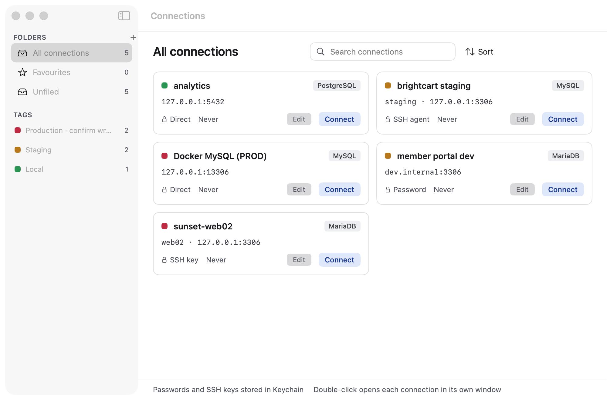
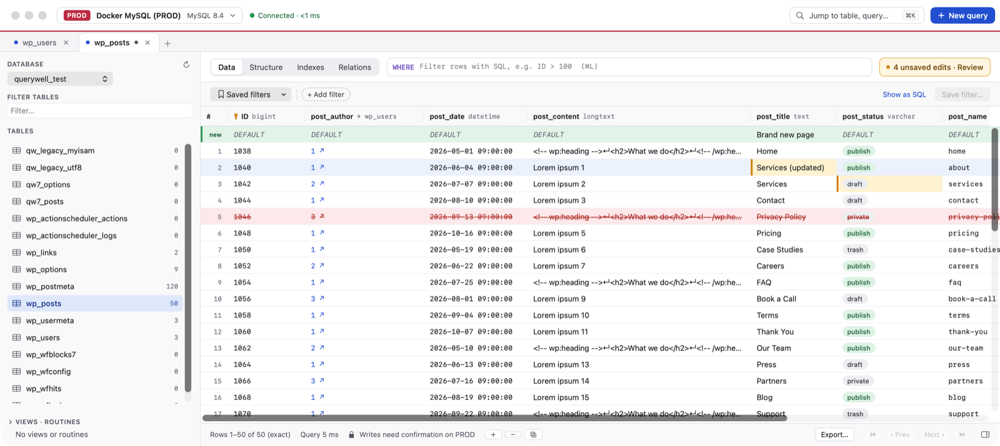
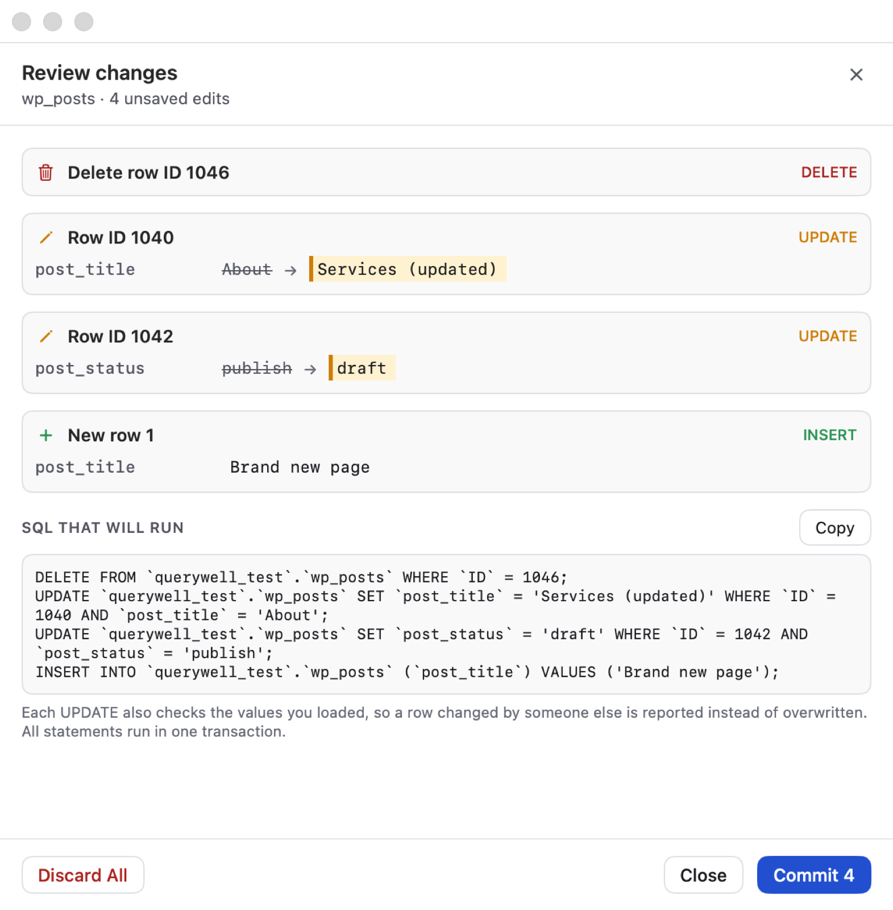
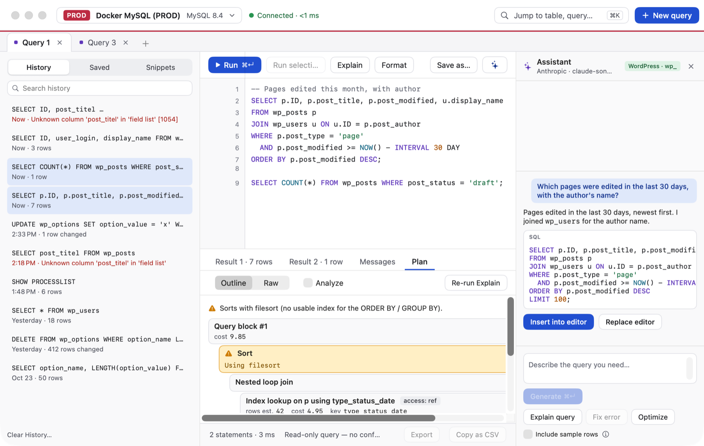
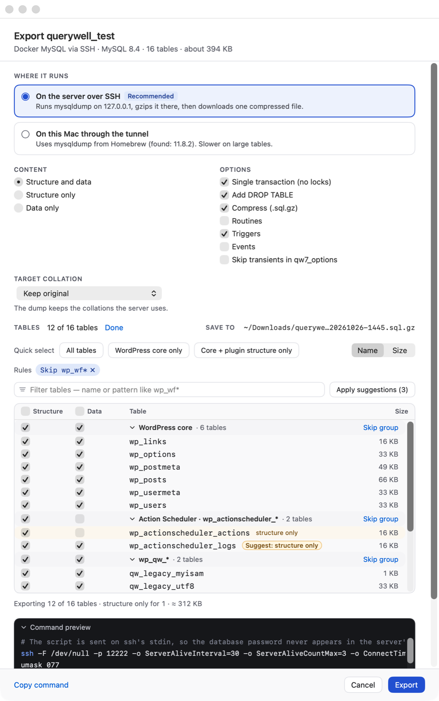
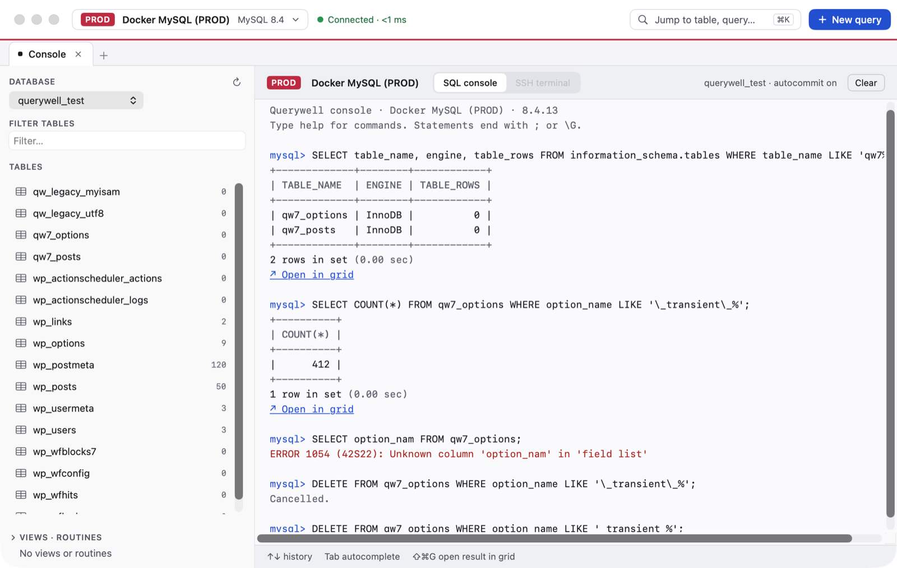
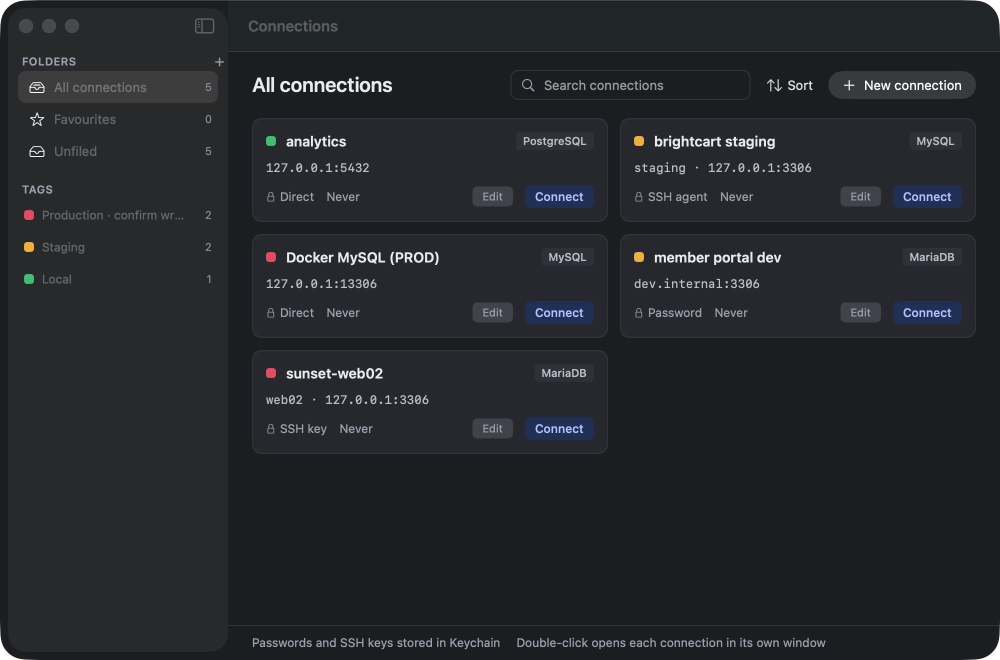

# Querywell

Querywell is a native macOS database client for MySQL, MariaDB and PostgreSQL, built with Swift 6, SwiftUI and AppKit. It is designed for people who live in their databases every day (WordPress and web-app work in particular): fast table browsing, safe inline editing that always goes through a review step, a proper query editor, serialization-aware search and replace, and import/export that copes with real-world dumps. It runs the system `ssh`, `mysqldump` and `pg_dump`, so it is distributed outside the Mac App Store and is not sandboxed.

## Features

**Connections and SSH**
- Saved connections with folders, tags, favourites, colour tags (Production / Staging / Local) and search.
- MySQL, MariaDB and PostgreSQL (with TLS modes); a *Test connection* button in the editor.
- SSH tunnels through the system OpenSSH, so `~/.ssh/config`, ProxyJump, agents (including 1Password) and every key format work. Host keys are verified against your `known_hosts`; a changed key is a hard failure.
- All secrets (DB and SSH passwords, passphrases, AI keys) live in the macOS Keychain only.

**Windows, tabs and quick open**
- One window per connection, with an in-window tab strip (table, query, console, terminal tabs).
- `⌘K` quick open: fuzzy-jump to tables, saved queries and actions.

**Table browser, filters and inline editing**
- Schema sidebar with database picker, fuzzy table filter, row estimates, views and routines.
- Virtualized data grid with type-aware headers, PK/FK markers, FK navigation, paging with exact or estimated counts, Structure / Indexes / Relations views and a row inspector.
- Column filters with chips, saved filters, a WHERE bar with autocomplete, and *Show as SQL*.
- Inline editing with insert, duplicate and delete. Changes stay pending until you press **Review**, which shows the exact SQL; commits are transactional with optimistic concurrency and conflict handling.
- Batch operations on selected tables: change storage engine, convert charset/collation.

**PROD safety**
- Production connections show a PROD badge, and every write (grid edits, queries, imports, DDL, search and replace) needs confirmation with a dry-run impact count and the typed database name. Read-only mode is a separate per-connection switch. See [Safety model](#safety-model).

**Query editor, history, saved queries and AI builder**
- In-house TextKit 2 SQL editor: highlighting, line numbers, bracket matching, autocomplete, snippets, formatter, error markers, Explain plan view, multiple result tabs and Messages.
- Run the selection or everything with `⌘↵`, the statement under the cursor with `⇧⌘↵`. Results of single-table queries with a key are editable through the same Review flow.
- Per-connection history (bounded), saved queries and snippets.
- AI query builder (`⇧⌘A`) with Anthropic, OpenAI or OpenRouter keys. It sends **schema only** by default and can only insert text into the editor; it never runs anything.

**Data editors and search and replace**
- JSON editor (tree or raw, key order and number formatting preserved) and PHP-serialized editor (tree, byte-exact round trip, explicit repair of damaged values).
- Serialization-safe search and replace across a database (`⇧⌘H`): rewrites inside PHP-serialized and JSON values with correct length prefixes, handles `\/`-escaped URLs, WordPress defaults (skips `guid`), dry run with samples, per-table transactions.

**Console and SSH terminal**
- SQL console with mysql-client style output (`\G`, continuation lines), running through the same write guard as the editor.
- SSH terminal tab (SwiftTerm running `/usr/bin/ssh`), with credentials supplied from the Keychain through a temporary askpass.

**Import and export**
- Export a database over SSH or locally with `mysqldump` / `pg_dump`: gzip, routines/events, WordPress transient skipping, and a live command preview.
- Per-table selection: Structure + Data / Structure only / Skip, grouped by plugin (WordPress core, WooCommerce, Action Scheduler, Wordfence and so on), filters with remembered per-connection rules and one-click suggestions for log/cache tables.
- Collation fix: rewrites DDL only (never row data) so a MySQL 8 dump (`utf8mb4_0900_ai_ci`) imports on MariaDB or MySQL 5.7, on export and on import (auto-suggested after a pre-scan).
- Streaming import of `.sql` / `.sql.gz` (drop a file on the window) with stop/continue on error; CSV, JSON and SQL INSERT export of tables and query results.

Dark mode is fully supported.

## Requirements

- macOS 14 (Sonoma) or later. Release builds are universal (Apple silicon and Intel).
- For export/import: `mysqldump` / `mysql` (`brew install mysql-client`) and/or `pg_dump` / `psql` (`brew install libpq`). Querywell finds them automatically and tells you when one is missing or older than the server.

## Install

Download `Querywell-<version>.dmg` from the releases, open it and drag **Querywell** to **Applications**. The app is signed with a Developer ID certificate and notarized by Apple. Verify the download with `SHA256SUMS.txt`.

## Build from source

Requires Xcode 26 and [XcodeGen](https://github.com/yonaskolb/XcodeGen).

    brew install xcodegen
    xcodegen generate
    open Querywell.xcodeproj

The Xcode project is generated from `project.yml` and is not committed.

## Tests

    scripts/ci.sh                      # xcodegen + swift build/test (Packages/Core) + xcodebuild build/test; warnings are errors
    scripts/ci.sh --skip-integration   # same without the Docker integration suite
    scripts/integration.sh             # Docker integration tests (MySQL 8.4, MariaDB 11.4, Postgres 16, SSH bastion)
    scripts/snapshots.sh               # UI snapshot suite (needs Docker); writes PNGs to build/snapshots/

`scripts/ci.sh` runs the Docker integration suite unless `--skip-integration` is given, and skips it automatically when Docker is not available.

## Release

`scripts/release.sh` produces a Developer ID signed, hardened-runtime, notarized and stapled `Querywell-<version>.dmg` and `.zip` plus `SHA256SUMS.txt` in `build/release/`.

One-time setup:

1. Install your *Developer ID Application* certificate (with its private key) in your login keychain. Check with `security find-identity -v -p codesigning`.
2. Store notarization credentials (app-specific password from appleid.apple.com):

        xcrun notarytool store-credentials "querywell-notary" \
          --apple-id "you@example.com" --team-id "ABCDE12345" --password "xxxx-xxxx-xxxx-xxxx"

Release:

    scripts/bump-version.sh 1.0.1            # optional; edits project.yml (version, build + 1)
    export QUERYWELL_TEAM_ID=ABCDE12345
    export QUERYWELL_NOTARY_PROFILE=querywell-notary
    scripts/release.sh

| Variable | Meaning |
|---|---|
| `QUERYWELL_TEAM_ID` | Required. 10-character Team ID. |
| `QUERYWELL_SIGN_IDENTITY` | Certificate name prefix, default `Developer ID Application`. |
| `QUERYWELL_NOTARY_PROFILE` | Keychain profile name given to `notarytool store-credentials`. |
| `QUERYWELL_VERSION`, `QUERYWELL_BUILD` | Override the version/build from `project.yml`. |

Flags: `--dry-run` prints every command without running it, `--no-notarize` makes a local signed build, `--skip-tests` skips the CI gate. `scripts/release.sh --help` has the details.

## Architecture

See [ARCHITECTURE.md](ARCHITECTURE.md) for the layout and rules, and [DECISIONS.md](DECISIONS.md) for the numbered design decisions. In short: all non-UI logic lives in the `Packages/Core` Swift package (library `QuerywellCore`: drivers, SSH, schema, editing and write guard, query engine, parsers, import/export, AI, persistence) and is unit-tested; the `App` target only renders state and forwards intents.

## Safety model

- **PROD guard:** connections tagged Production require confirmation for every write, with a typed database name. The confirmation shows a dry-run count of affected rows where one can be computed.
- **Read-only mode:** a separate per-connection switch that blocks writes entirely.
- **One execution path:** the editor, console, history re-runs, saved queries, AI-inserted SQL, imports and search and replace all go through the same guard. Nothing the AI writes is ever run automatically.
- **Edits via review:** grid edits are pending until reviewed; the exact SQL is shown, committed in one transaction, and rejected rows that changed underneath you are reported as conflicts.
- **Dry runs:** search and replace and destructive operations preview their effect first.

## Privacy

- Passwords, passphrases and API keys are stored in the macOS Keychain only. Connection metadata is plain JSON in `~/Library/Application Support/Querywell/` (directory `0700`, files `0600`), without secrets.
- The AI builder sends the schema (table and column names and types) only. Sample rows are a per-connection opt-in (up to 3 rows from the most related tables). Requests go directly from your Mac to the provider you configured.
- Query history is per connection and bounded (by default 1,000 entries, 90 days, 2 MB); secrets in statements are redacted before they are stored. Deleting a connection deletes its history, saved queries and export rules.
- Remote exports never put the database password in a command line or the server environment.
- No telemetry.

## Keyboard shortcuts

| Shortcut | Action |
|---|---|
| `⌘N` | New connection |
| `⌘0` | Connections launcher |
| `⌘F` (launcher) | Find connections |
| `⌘K` | Quick open |
| `⌘T` | New query tab |
| `⌘W` | Close tab / window |
| `⌘1` ... `⌘9` | Select tab |
| `⌃⇥` / `⌃⇧⇥` | Next / previous tab |
| `⌘F` (sidebar) | Filter tables |
| `⌘R` | Refresh schema |
| `⌘L` | Focus WHERE bar |
| `⌥⌘G` | Focus grid |
| `⌥⌘I` | Toggle row inspector |
| `⌥⌘N` | Add row |
| `⌘S` | Review pending changes / save query |
| `⌘↵` | Run selection or all statements |
| `⇧⌘↵` | Run statement at the cursor |
| `⌘E` | Explain |
| `⌥⌘F` | Format SQL |
| `⇧⌘A` | Toggle AI assistant |
| `⇧⌘H` | Search and replace |
| `⇧⌘E` / `⇧⌘I` | Export database / Import SQL |
| `⇧⌘G` | Console: open result in a grid |

## Known limitations

- Optimistic-concurrency checks (grid edits, search and replace) compare with the column's collation on MySQL, so a concurrent change that differs only in letter case or trailing spaces is not detected as a conflict (DECISIONS #40).
- The database drivers cannot yet abort a running statement, so Stop takes effect between statements, and very large results are loaded into memory rather than streamed. Console output is capped at 1,000 rows per result; open the rest in a grid.
- PostgreSQL composite and geometric types arrive as raw bytes; zero-row SELECT results re-run as a wrapper query to learn the column names (DECISIONS #21).
- WordPress transient skipping on export is MySQL-only; databases with two WordPress prefixes pick one.
- Postgres collation/locale differences are not rewritten on import/export (the collation fix is MySQL/MariaDB only).
- The terminal uses SwiftTerm 1.11.2, pinned because newer releases need the optional Xcode Metal toolchain and package plugin validation (DECISIONS #41).
- The app icon is a placeholder.

## License

All rights reserved. License to be decided by the owner.
